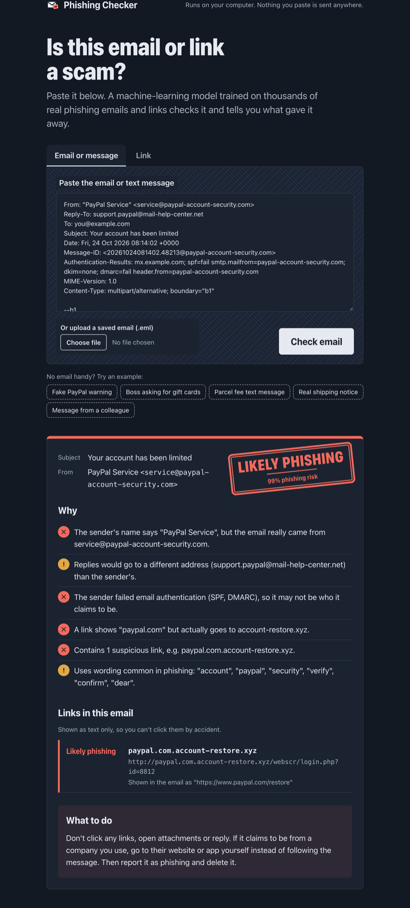

# AI Phishing Checker

Paste a suspicious email, text message or link and find out whether it's phishing, and *why*.

The checker runs entirely on your own computer. It uses machine-learning models trained on tens of thousands of real phishing and legitimate messages and hundreds of thousands of links. Nothing you paste is sent to any server, and there's no API key or account to set up.



## What it does

- **Checks emails and text messages.** Paste the text, or upload a saved `.eml` file for the most thorough check.
- **Checks links.** Paste a URL before you click it.
- **Explains its verdict** in plain language, for example:
  - "The sender's name says PayPal, but the email really came from service@paypal-account-security.com"
  - "A link shows paypal.com but actually goes to account-restore.xyz"
  - "paypa1.com is a look-alike of paypal.com"
  - "The sender failed email authentication (SPF, DMARC)"
  - "Uses wording common in phishing: verify, suspended, confirm..."
- **Gives a clear result:** *Looks safe*, *Suspicious* or *Likely phishing*, with a risk percentage and advice on what to do.
- **Shows every link in an email** with its own rating. Links are displayed as text only, so you can't click them by accident.
- Comes with **example emails and links** so you can try it straight away.

## Quick start

You need [Python 3.11 or newer](https://www.python.org/downloads/) and [Git](https://git-scm.com/downloads).

**macOS / Linux**

```bash
git clone https://github.com/PapkoSD/aiphishingchecker.git
cd aiphishingchecker
python3 -m venv .venv
source .venv/bin/activate
pip install -r requirements.txt
python -m phishchecker
```

**Windows (PowerShell)**

```powershell
git clone https://github.com/PapkoSD/aiphishingchecker.git
cd aiphishingchecker
py -m venv .venv
.venv\Scripts\Activate.ps1
pip install -r requirements.txt
python -m phishchecker
```

Your browser opens at <http://localhost:8000>. Press `Ctrl+C` in the terminal to stop the checker.

Next time you only need to activate the environment (`source .venv/bin/activate` or `.venv\Scripts\Activate.ps1`) and run `python -m phishchecker`.

Options:

```bash
python -m phishchecker --port 9000      # use a different port
python -m phishchecker --no-browser     # don't open the browser automatically
```

## Run with Docker

If you have [Docker](https://www.docker.com/get-started/) you don't need Python at all:

```bash
git clone https://github.com/PapkoSD/aiphishingchecker.git
cd aiphishingchecker
docker build -t phishchecker .
docker run --rm -p 127.0.0.1:8000:8000 phishchecker
```

Then open <http://localhost:8000>.

## How to check an email properly

Pasting the text of an email works, but the checker can see much more in the **original message**: the real sender address, the Reply-To address and whether the email passed SPF, DKIM and DMARC authentication.

| Email app | How to get the original |
| --- | --- |
| Gmail (web) | Open the email, click **⋮** > **Download message** to get an `.eml` file, or **Show original** and copy everything |
| Outlook (web) | Open the email, click **⋯** > **View** > **View message source**, copy everything |
| Outlook (desktop) | Drag the email to your desktop to save it, or **File** > **Save As** |
| Apple Mail | **File** > **Save As**, format **Raw Message Source** |
| Thunderbird | **File** > **Save As** > **File** (saves an `.eml`) |

For links, right-click the link and choose **Copy link address**. Don't open it first.

## How it works

Two models do the main work. Both are linear models (logistic regression), which makes it possible to show exactly which words or features pushed a message towards "phishing".

**Email and message model.** The text is cleaned up: links, email addresses, amounts of money and numbers are replaced with placeholders, so the model learns patterns rather than specific values. Then it's turned into [TF-IDF](https://en.wikipedia.org/wiki/Tf%E2%80%93idf) features over single words and two-word phrases.

**Link model.** It combines two kinds of features:
- character patterns in the URL, such as `-secure-` or `verify-acc`;
- 20 hand-crafted features: is the host an IP address, does a brand name appear outside the real domain, is it a URL shortener, does it use a suspicious domain ending, is there an `@` hiding the real host, and so on.

**Extra checks.** On top of the models the analyzer:
- treats links on official websites (from [`trusted_domains.txt`](phishchecker/data/trusted_domains.txt)) as safe, so real login pages like `paypal.com/signin` aren't flagged;
- warns about services where anyone can host content (Google Sites, Dropbox, GitHub Pages...), because phishers use them to look trustworthy;
- spots look-alike domains (`paypa1.com`, `rnicrosoft.com`);
- follows redirect links (`google.com/url?q=...`) and rates the real destination;
- checks the sender's display name against the actual address, the Reply-To address, SPF/DKIM/DMARC results and risky attachments (`.html`, `.exe`, `.iso`, macro-enabled Office files...).

### How accurate is it?

Scores on test data the models never saw during training:

| Model | Accuracy | Precision | Recall | ROC AUC | Test size |
| --- | --- | --- | --- | --- | --- |
| Emails and messages | 99.4% | 99.4% | 98.3% | 0.999 | 3,772 messages |
| Links | 90.0% | 86.6% | 89.8% | 0.969 | 109,067 links |

The link model is tested only on **websites that don't appear anywhere in its training data** (the split is grouped by domain). That's a harder and more honest test than a random split, which would let the model recognise sites it already knows.

Real-world accuracy will be lower than the email number suggests. Public datasets are older and cleaner than what lands in your inbox today. During development the email model was also checked against 18 hand-written modern emails it hadn't seen and got 15 of them right. It misses non-English messages, and it sometimes rates genuine security alerts or CEO-fraud emails as *Suspicious* rather than a clear verdict.

### Limitations

- **English only.** Messages in other languages are likely to be rated "safe".
- The checker never visits links, so it can't see what a page looks like or where a shortened link really goes.
- New phishing tricks appear every day. Treat the result as a second opinion, not a guarantee.

## API

The app also has a small JSON API, handy for scripts or testing:

```bash
curl -X POST http://localhost:8000/api/check/url \
  -H "Content-Type: application/json" \
  -d '{"url": "http://paypal.com.account-restore.xyz/login"}'

curl -X POST http://localhost:8000/api/check/email \
  -H "Content-Type: application/json" \
  -d '{"text": "Your account has been suspended. Verify your identity now: http://secure-bank-update.com"}'

curl -X POST http://localhost:8000/api/check/email -F "eml=@samples/phishing_paypal.eml"
```

Every response includes `verdict` (`safe`, `suspicious` or `phishing`), `score` (0 to 1) and a list of `reasons`.

## Add your own trusted websites

Open [`phishchecker/data/trusted_domains.txt`](phishchecker/data/trusted_domains.txt), add your bank, employer or school (one domain per line, e.g. `mybank.com`) and restart the checker. Links on those domains will be treated as genuine, and look-alikes of them will be flagged.

## Retrain the models

The trained models ship with the repo in `phishchecker/models/`, so you don't need to do this to use the checker. If you want to experiment:

```bash
python training/download_data.py      # ~150 MB, saved to data/raw/
python training/train_email_model.py  # ~30 seconds
python training/train_url_model.py    # a few minutes, needs a few GB of RAM
```

The scripts print the test scores and update `phishchecker/models/metrics.json`. Two problems with the public data that the training scripts work around (details in the comments):

- In the URL data, legitimate links almost never start with `https://` and always have a path, while many phishing links are bare domains. Left alone, the model would learn that `https://` or a plain domain means phishing.
- Half of the older email data labelled "phishing" is ordinary spam. That taught the model to flag every receipt and newsletter, so it's left out, and real phishing from the Nazario corpus is used instead.

## Run the tests

```bash
pip install pytest
pytest
```

## Project structure

```
phishchecker/
  __main__.py         starts the app (python -m phishchecker)
  app.py              web pages and JSON API (Flask)
  analyzer.py         scores emails/links and builds the explanations
  email_parser.py     reads pasted text and .eml files: headers, body, links, attachments
  url_features.py     URL clean-up and hand-crafted features
  text_features.py    email text clean-up
  domains.py          trusted domains, user-content hosts, look-alike detection
  data/trusted_domains.txt
  models/             trained models + test scores
  templates/, static/ the web page
training/             scripts to download data and retrain the models
samples/              example emails and links to try
tests/                automated tests
```

## Credits

Training data:

- [ealvaradob/phishing-dataset](https://huggingface.co/datasets/ealvaradob/phishing-dataset) on Hugging Face, licensed Apache-2.0
- [Phishing Email Curated Datasets](https://doi.org/10.5281/zenodo.8339691) by Al-Subaiey et al., licensed CC BY 4.0. The Nazario and Nigerian Fraud sets are used.

The [Archivo](https://github.com/Omnibus-Type/Archivo) typeface is bundled under the SIL Open Font License (see `phishchecker/static/fonts/OFL.txt`).

## License

[MIT](LICENSE)
